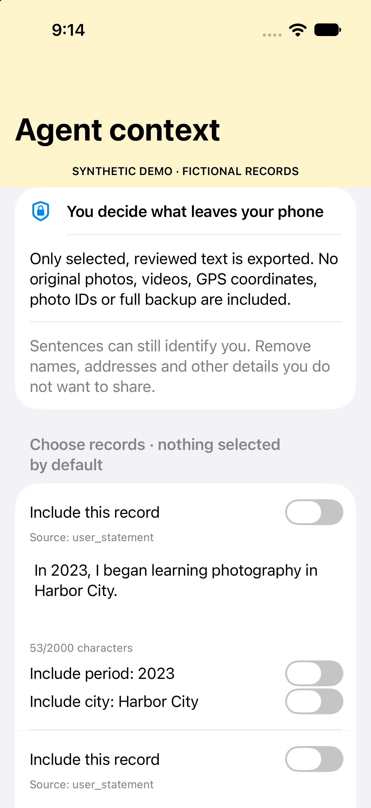

# Atlas Context

**Turn selected phone memories into cited Agent summaries, with a review before sharing.**

[](https://github.com/niulengxiao/atlas-context/actions/workflows/ci.yml)

[Chinese translation](README.zh-CN.md) · [Phone to Agent](docs/phone-handoff.md) · [Privacy](PRIVACY.md) · [MCP setup](docs/mcp.md) · [Roadmap](ROADMAP.md) · [MIT license](LICENSE)

Atlas Context turns selected life records into bounded, traceable context for tasks such as writing a short biography or a yearly reflection. You choose the records, review the exact outgoing text and set a local approval period. The context preserves the difference between recorded material, your own statements and system inferences.

**Status: experimental alpha.** A reusable iOS review/export component, a fictional companion app, a strict phone-file connector and a read-only MCP stdio server are implemented. The intended flow is **select on phone → review exact wording → transfer JSON → connect → ask your Agent for a cited summary**. Automatic USB scanning, production Atlas Memoir integration and live phone synchronization are not implemented. See the [phone guide](docs/phone-handoff.md) and [validation scope](docs/evidence.md).

> **Privacy first:** nothing is selected by default. The phone export contains reviewed text, not original photos, videos, GPS, photo IDs or a full backup. Cloud access defaults off. Using a cloud Agent sends approved text to its provider; revocation blocks future reads but cannot recall previous copies. Text can still contain identifying details. Read the [full privacy statement](PRIVACY.md).

## Connect a fictional phone story in one command

```sh
python3 -m atlas_context.phone demo --output ../atlas-phone-demo
```

This creates a minimal fictional phone bundle, a private MCP session and a three-record cited evidence preview. It makes no model call. Bind `session/private-server.json` to your MCP host, then give the Agent `session/private-agent-task.md` for a short overview, timeline, citations and evidence limits. Use a local model for the default `local_only` session. For iPhone setup and real reviewed files, follow [Phone to Agent](docs/phone-handoff.md). Agents should read [AGENTS.md](AGENTS.md) first.



The new standalone iOS companion uses fictional records and requests no Photos permission. It provides the review/export component; it is not an installed Atlas Memoir production release.

## See the product background

Atlas Memoir is the native timeline and correction product behind this exploration. These are actual app views rendered in an isolated build with entirely fictional records. The pictured sharing screen is a separate feature from Agent approval. The new [phone review/export component](docs/phone-handoff.md) is provided separately for integration; these older screenshots do not show it.

<p>
  
  
  
</p>

[18-second screenshot walkthrough](docs/assets/atlas-app-walkthrough.mp4) · [App showcase and provenance](docs/app-showcase.md)

## Why this project

A photo timestamp can locate a moment; it rarely explains what that moment meant to you. A useful writing assistant needs your explanation, a way to inspect its sources and a clear boundary around what you agree to disclose.

Atlas Context explores that boundary. Its first task is small: prepare a few reviewed records for one personal introduction or reflection. It does not require a complete life archive. Permission to share a statement does not establish that statement as true.

## Try it with fictional records

The core needs **Python 3.10+** and the standard library only. The optional MCP integration needs **Python 3.11+**. No API key is needed for either synthetic demo. Run from the repository root:

```sh
python3 -m atlas_context.synthetic --output ../atlas-story-demo
python3 -m atlas_context.cli preview \
  --draft ../atlas-story-demo/private-draft.json \
  --grant ../atlas-story-demo/private-grant.json \
  --purpose write_short_bio --audience synthetic_agent --query photography
```

This generates a fictional three-year story: **16 drafts, 14 explicitly selected records, 13 default outgoing records and 8 query scenarios**. Photography returns seven records. Unselected entries, hidden entries, raw OCR and an unsupported employer query return no evidence; an inferred trip stays labeled as inference. The approval is scripted only because the input and reviewed wording are known fictional fixtures. Real imports still require an explicit local review.

To verify the actual MCP stdio connection, create an environment outside the checkout using Python 3.11+, then run:

```sh
python3 -m venv ../atlas-env
../atlas-env/bin/python -m pip install '.[mcp]'
../atlas-env/bin/python -m atlas_context.mcp_demo --output ../atlas-mcp-demo
```

The MCP demo checks **16 conditions**, including a narrow tool schema, approved-only retrieval, strict argument types, source revision changes, expiry, purpose/audience mismatch and revocation on the same live connection. It intentionally leaves its demo grant revoked. Generated files remain outside this repository. See [demo details](docs/demo.md) and [host configuration](docs/mcp.md).

Three actual Codex client examples are documented separately: [a cited introduction, insufficient employer evidence and a revoked grant](docs/agent-demo.md). They use fictional inputs and were manually inspected; they are not a general model-quality benchmark.

The original four-record minimal example also remains available:

```sh
python3 demo.py --output ../atlas-synthetic-runtime
python3 -m atlas_context.cli preview \
  --draft ../atlas-synthetic-runtime/private-draft.json \
  --grant ../atlas-synthetic-runtime/private-grant.json \
  --purpose write_short_bio \
  --audience synthetic_agent \
  --query photography
```

Choose an empty output directory. The demo never replaces existing files. Its sample grant expires after one hour; use a new empty directory to generate another demo.

The demo creates four private draft records and approves three. Default retrieval returns two approved records, excluding the inferred trip. It checks four scenarios:

| Query | Expected result |
|---|---|
| Photography experience (`photography`) | Two reviewed records |
| Unapproved OCR detail | No authorized evidence |
| Inferred trip, default search | No authorized evidence |
| Inferred trip, explicitly included | One record, still labeled `inferred` |

It also checks revocation, local citation resolution and that importing the generated media catalog leaves it unchanged. Output files are written outside the source directory. Even draft, grant and preview files without media are private runtime data.

One returned item looks like this; its opaque citation changes between demo runs:

```json
{
  "citation": "E-4969f55dd5150e8c",
  "attribution": "user_statement",
  "wording": "user_reviewed",
  "source": "atlas_memoir",
  "text": "In 2025, I started learning photography.",
  "evidence_label": "User-written stage summary (synthetic)",
  "period": "2025"
}
```

The full response includes a coverage note: missing records do not establish that an event never happened. This output is a context preview, not an answer generated by an agent.

## How the pieces fit

```text
Atlas summary projection ──┐
                          ├─> Private drafts ─> Local wording review
Selected media rows ──────┘                           │
                                                     v
                                         Purpose + audience + expiry
                                                     │
                                                     v
                                         Search approved text only
                                                     │
                                                     v
                                         Context preview + citations
```

- **Local Media Library** organizes media and notes. This prototype reads explicitly selected catalog rows in read-only mode.
- **Atlas Memoir** is the intended timeline and correction interface. Its summary adapter accepts a supplied projection. A reusable SwiftUI selective exporter and fictional companion app now provide a versioned phone handoff; production app integration remains pending. Full backup envelopes are rejected.
- **Atlas Context** contains the reusable review and retrieval core in this repository.
- **Agent integration** can consume approved context using the read-only `search_life_context` MCP stdio tool. Its grant, files, purpose and audience are bound by trusted local configuration, outside model arguments.

## Implemented boundaries

| Rule | Current behavior |
|---|---|
| Explicit selection | Import creates drafts, with no implicit disclosure permission |
| Exact wording | Local approval stores the text the user chooses to disclose; no automatic prose redaction |
| Bounded access | Each query checks local purpose, audience, expiry and active status |
| Approved-only search | Searches approved text, year/month and city; private titles, raw OCR and source locations are not searched |
| Source attribution | Keeps `recorded`, `user_statement` and `inferred` distinct; inference is excluded by default |
| Changed records | A changed draft revision excludes that record until it is reviewed again |
| Source inspection | Opaque citations resolve through a separate trusted local function; original handles are absent from the outgoing structure |

Optional outgoing fields are a year or month, a city and a reviewed evidence label. Exact source locations and original media are not returned by the query function. **Review the text itself:** a sentence can still disclose personal information, regardless of which field contains it.

## Current limits

- Audience and purpose are **local policy labels**, not authenticated identities. Grant files are trusted local configuration, not signed credentials. A process with permission to edit them can change them.
- Revision checks compare the supplied draft with its approved revision. This prototype does not watch the original app or media library for changes; a future integration must refresh drafts when sources change.
- Atlas full-backup decoding, migrations, production app integration and live source refresh are outside this prototype. The separate phone export is a minimal reviewed projection. Media adapters and phone handoff checks use fictional records, not personal libraries.
- Citations support inspection; they do not prove that reviewed wording is supported by the source. Retrieved text is marked as untrusted evidence, which does not by itself establish prompt-injection resistance in a future model.
- Sending context to a cloud model sends that text off the device. Revocation blocks future reads from this layer; it cannot recall copies already received by a client or model.
- Encryption at rest, multi-user isolation, large-library performance and actual agent answer quality have not been validated.

See [MCP setup and boundaries](docs/mcp.md), the [evidence checklist](docs/evidence.md) and the [roadmap](ROADMAP.md) for the next milestones.

## Development

```sh
python3 -m unittest discover -s tests -v
python3 scripts/check_release.py
python3 -m atlas_context.cli --help
```

The suite covers approval rules, private-field exclusion, revision changes, expiry, revocation, read-only adapters, the real MCP subprocess transport and publication history. MCP-specific tests skip when the optional extra is absent. [GitHub Actions](https://github.com/niulengxiao/atlas-context/actions/workflows/ci.yml) runs core checks on Python 3.10/3.12 and MCP checks on Python 3.11/3.12. The release guard checks the public file allowlist, reviewed-media hashes, common credential/path patterns and Git history. It supports manual review; it cannot recognize every form of private content.

```text
atlas_context/
  core.py             # Records, local approval, retrieval, local evidence lookup
  importers.py        # Summary projection and selected media catalog adapters
  cli.py              # Local import, approval and context preview commands
  synthetic.py        # Fictional three-year fixture generator
  mcp_server.py       # One read-only stdio tool, with host-bound configuration
  mcp_demo.py         # Real SDK client/server roundtrip and invalidation checks
  phone.py            # Strict reviewed phone handoff, local session and revocation
mobile/               # SwiftUI review/export component and fictional iPhone demo
demo.py               # Generates fictional records and checks four scenarios
tests/test_context.py # Synthetic behavior tests
scripts/check_release.py
PUBLIC_FILES          # Explicit source-release allowlist
PUBLIC_MEDIA          # Exact hashes of manually reviewed synthetic showcase assets
```

## Public code, private records

This repository contains code, documentation, synthetic fixture generators and five explicitly reviewed synthetic showcase assets. Keep real photos, videos, catalogs, OCR, notes, drafts, grants, phone exports, context exports, access logs, credentials and real-data screenshots outside every Git checkout. All other media files are rejected. `.gitignore` is a convenience, not a privacy boundary; ignored files can still be force-added or included in an archive.

Contributions should reproduce issues with synthetic records. See [CONTRIBUTING.md](CONTRIBUTING.md). Code is released under the [MIT license](LICENSE); personal runtime records are not part of the source release.
