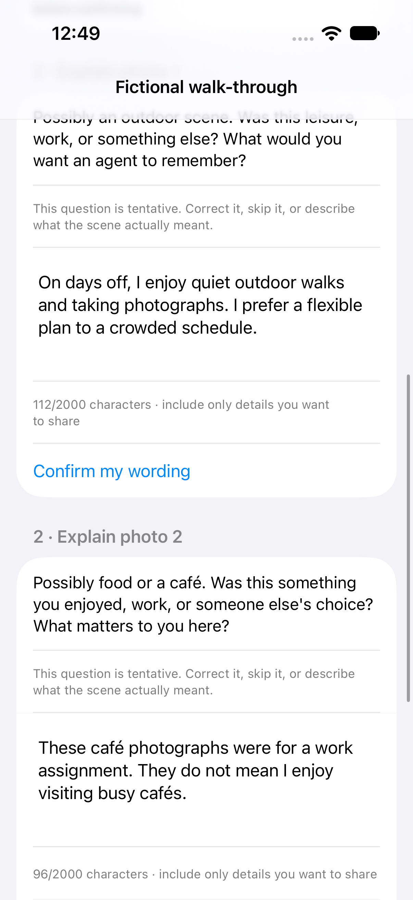

# Atlas Context

**Help your agent understand the life behind your requests.**

[](https://github.com/niulengxiao/atlas-context/actions/workflows/ci.yml)

[Review in five minutes](docs/reviewer-guide.md) · [Chinese translation](README.zh-CN.md) · [Phone setup](docs/phone-handoff.md) · [Privacy](PRIVACY.md) · [Evidence](docs/evidence.md) · [MIT license](LICENSE)

Atlas Context is an open-source, consent-aware personal context layer for AI agents. Selected everyday photos provide clues; **your explanations give them meaning**. You confirm what mattered, choose the exact text to share and let an agent use that background for a specific task, with citations and control over future access.

For developers, the reusable pieces are a SwiftUI photo-reflection and selective-export flow, a strict Python phone connector, exact-wording approval and one read-only MCP tool. They work independently of a particular model provider. The intended value is less repeated explanation and assistance grounded in the person's stated experiences, interests and tradeoffs.

**Status: experimental alpha.** Local scene classification and fixed questions are implemented. Generative photo understanding, autonomous clarification dialogue, durable preference learning, production Atlas Memoir integration and physical-device transfer remain planned or unverified. There is no claim of broad adoption or improved real-user outcomes.

> **Privacy first:** no full-library scan, no exported originals, GPS or photo identifiers, and no records selected for disclosure by default. Cloud access defaults off. Approved text can still identify you. Revocation stops future reads; it cannot recall copies already received. See [PRIVACY.md](PRIVACY.md).

## Try it without a phone or API key

Use Python 3.10+:

```sh
git clone https://github.com/niulengxiao/atlas-context.git
cd atlas-context
python3 -m atlas_context.review_demo --output ../atlas-review-demo
```

Expected: **nine checks passed, zero model calls and zero network calls**. Open `../atlas-review-demo/private-review-walkthrough.md` locally. Everything is fictional, and the preview repeats exact reviewed statements rather than generating advice. Use a new output directory each time.

The example person likes quiet walks and flexible days off. Their café photos were for work, so no café-hopping preference is created. The walkthrough then explicitly revokes the old session and separately reviews a new preference for a structured indoor art workshop. The old access stays denied. This demonstrates the correction and authorization lifecycle; it does not automatically refresh a phone source or maintain long-term memory.

For an actual agent, follow [MCP setup](docs/mcp.md) and bind the generated `corrected-session/private-server.json`. Use a local model for its default `local_only` policy. Ask for a day-off plan and use the generated task instructions to require cited personal claims, alternatives and a check that the preference still applies. A model and trusted host must be configured separately.

The [reviewer guide](docs/reviewer-guide.md) also provides an actual SDK transport demo, expected results, code pointers and current limitations.

## From a photo to context you control

```text
Up to five chosen photos → Local scene question → Your explanation/correction
          → Confirm your words → Separately review disclosure
          → Transfer reviewed JSON → Connect read-only MCP → Ask your agent
```

Apple's on-device Vision classifier supplies a tentative outdoors, food/café, creative or neutral question. It does not determine what an experience meant or infer a personality. Real selected images start with blank explanations. Editing your explanation clears its confirmation. Confirmed text still starts unselected in the separate export screen, where cloud use is off and the full JSON must be reviewed before saving.

The app keeps images and explanations in memory. **Clear this session** removes that session; previously exported copies need separate revocation/deletion. The system picker may download an explicitly selected iCloud photo. File providers may upload the saved JSON independently of any agent. Phone connection and Agent access are explicit, not an automatic USB scan.

Generate the standalone iOS 18+ companion in Xcode:

```sh
python3 scripts/create_phone_project.py --output ../atlas-phone-app
open ../atlas-phone-app/AtlasPhoneDemo.xcodeproj
```

Choose **Try fictional walk-through** to avoid library access, or explicitly select up to five images. A physical device needs your signing team. Full steps and the versioned export contract are in [Phone setup](docs/phone-handoff.md).

<p>
  
  
</p>

These are actual isolated app views with fictional records. The second screenshot shows the earlier text-export component. [Asset provenance and original Atlas Memoir app views](docs/app-showcase.md) distinguish the standalone companion from the production app.

## What another project can reuse

| Piece | Implemented behavior |
|---|---|
| Photo reflection | System picker, bounded local scene questions, user explanation and confirmation invalidated by edits |
| SwiftUI export | Exact text selection, optional coarse metadata, task/disclosure mode and complete JSON review |
| Python connector | Strict minimal schema, exact-file review hash, bounded lifetime and private runtime outside Git |
| Approval/retrieval core | Approved projections only, source attribution, draft revision checks, purpose, audience, expiry and revocation |
| MCP integration | One stdio tool, `search_life_context`; the model cannot choose files, widen a grant or read originals |

The Python core uses the standard library on Python 3.10+. Optional MCP support uses Python 3.11+ and pinned SDK 2.3.0. Developers can embed the phone views or consume the reviewed file format and MCP tool independently. See [integration configuration](docs/mcp.md) and [contribution guidance](CONTRIBUTING.md).

## Built on the experience of Atlas Memoir

[Atlas Memoir](https://atlasmemoir.com/) is a separate iPhone product for reviewing life chapters and journeys, [available on the App Store](https://apps.apple.com/us/app/atlas-memoir/id6797416641). It provides product experience behind this project, not evidence of Atlas Context adoption. Its production integration with Atlas Context is not complete. The open-source companion runs independently.

Phone files are labeled `phone_export`: the unsigned v1 format does not establish which app produced them. This source label is separate from `user_statement`, `recorded` or `inferred` attribution, and citations identify reviewed wording rather than verified photo content.

## Bounded retrieval and repeatable evaluation

Search uses normalized whole words and overlapping Han-character bigrams, ranked by matching terms. It searches approved text and optional reviewed period/city only. It is lexical retrieval, not semantic understanding. Empty queries retain an explicit overview mode. Defaults cap each response at 10 records and 6,000 characters of reviewed text/labels, without cutting sentences; `retrieval.has_more` signals omitted authorized matches. See [the tool contract and limits](docs/mcp.md).

```sh
python3 -m atlas_context.evaluation --output ../atlas-evaluation
```

This prepares **15 fixed fictional tasks, 45 planned model conditions and 60 mechanical checks**. It makes zero model/network calls. The same prompt is used for each task without context, with original context and with a separately reviewed correction. The pack includes Chinese tasks, unknown facts, scope changes and adversarial quoted text. [Evaluation instructions](docs/evaluation.md) separate access checks, citation support and usefulness; preparing the pack does not establish model quality or prompt-injection resistance.

A separate [nine-condition actual Codex smoke test](docs/controlled-host-smoke.md) publishes all outputs for English, Chinese and quoted-instruction tasks. All ten cited IDs matched returned evidence; the limited attack did not redirect the answer. These single-run observations have no independent usefulness score, and the per-run resolved model identifier was not captured.

## Evidence and limits

- [Validation scope](docs/evidence.md) separates core tests, actual SDK transport, Swift/Python serialization, local image checks, native UI checks and limited actual Codex examples.
- [Agent examples](docs/agent-demo.md) show cited summaries and contextual help with fictional inputs. They are examples, not a general model-quality benchmark.
- [One request, three context conditions](docs/context-comparison.md) shows actual host outputs without context, with approved context and after a separately reviewed correction.
- [Additional synthetic demos](docs/demo.md) cover richer life histories, unsupported details and explicitly labeled inference.
- [Product direction](docs/product-direction.md) and [roadmap](ROADMAP.md) explain the intended personal-agent experience and what remains to build.

Purpose and audience are local policy labels, not authenticated client identities. A trusted host can copy files, and the server cannot attest to its network behavior. Cloud use requires explicit phone and desktop opt-in and sends the approved text to the model provider. Encryption at rest and multi-user isolation are not implemented.

Citations identify reviewed evidence; they do not independently verify a statement. In the photo-reflection flow they refer to the exported user wording, not original pixels. Missing records do not show that an event never happened. Retrieved text is untrusted evidence, not instructions; universal prompt-injection resistance is not established.

## Development and reporting

```sh
python3 -m unittest discover -s tests -v
python3 scripts/check_release.py
```

MCP-dependent tests skip when the optional SDK is absent. [CI](https://github.com/niulengxiao/atlas-context/actions/workflows/ci.yml) checks core Python versions, actual MCP transport, installed-package operation and the fictional evaluation pack. Relevant phone changes, tags and manual runs also compile iOS, check Swift contracts/local image metadata and run four native review/export interaction tests on a new simulator. Documentation-only changes keep the Python/publication checks and skip the macOS job. See actual run results and [validation scope](docs/evidence.md).

The repository contains code, fictional fixture generators and manually reviewed synthetic showcase assets. `PUBLIC_FILES` and `PUBLIC_MEDIA` define the exact publication allowlists. Keep real photos, life records, exports, grants, logs, credentials and personal screenshots outside every Git checkout. The guard supports manual review; it cannot recognize every private fact in prose.

Use [fictional bug reports or the private privacy/security channel](docs/reporting.md). Code is [MIT licensed](LICENSE); personal records are not part of the source release.
