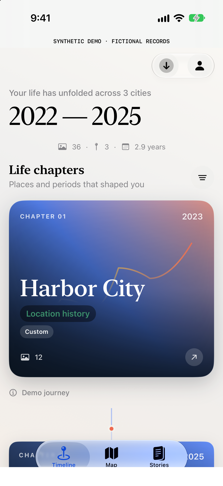
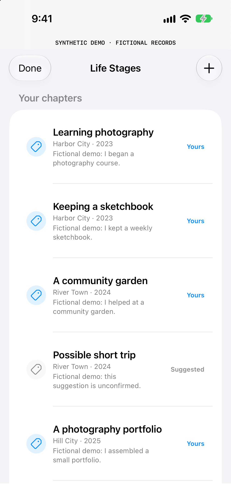
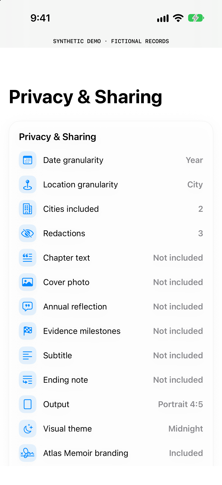

# Atlas Memoir: product background

Atlas Memoir supplies the product context for Atlas Context: people can inspect a timeline, describe a chapter in their own words and distinguish their interpretation from a system suggestion.

These are screenshots of **actual native views**, rendered in a separate build with an entirely new fictional fixture. They are not images generated to imitate a working app. The app's full source and binary are not included in this repository.

  
  
  

[Watch the 18-second screenshot walkthrough](assets/atlas-app-walkthrough.mp4). It is a slideshow of these three screenshots, not a recording of an integrated app-to-Agent workflow.

## What the views demonstrate

- **Timeline:** a visual entry point for chapters and city-level evidence.
- **Life stages:** user statements remain distinct from suggested interpretations.
- **Privacy & Sharing:** the native app has a separate review surface for social exports. This does not grant Agent access and is not the Atlas Context approval UI.

The screenshot harness shows six fictional chapters and simulated counts. It replaces sample content, disables photo refresh and commercial startup tasks, preserves fictional city labels, and adds a synthetic-data banner. Editor callbacks in this harness do not persist changes. The displayed date-range header is approximate presentation; the generator's dates define the synthetic retrieval cases.

## Asset provenance

Captured on a new, task-specific iPhone simulator with no personal archive or imported media. Screens use only new hard-coded fictional records; graphic covers are app-rendered gradients. No existing screenshots, personal photos, real location history or original archive contents were copied into the public assets. The device clock and status bar were set to generic values.

PNG EXIF and text metadata were removed without changing their pixel data. The silent video was assembled from the reviewed screenshots with metadata stripped. `PUBLIC_MEDIA` records the exact SHA-256 of every published asset; the release guard rejects changes until they are reviewed again. Hashes establish which bytes were reviewed, not whether arbitrary content is private: manual inspection remains necessary.

## Integration status

The Python summary adapter and MCP server run independently today. The native selective exporter and native Agent approval UI are still planned. These views show the project's existing product background; they do not establish external adoption, App Store availability or an already connected native Agent feature.
